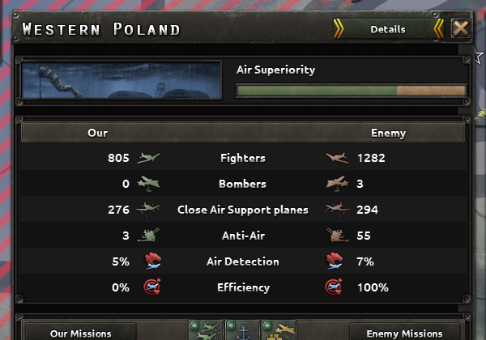

# Design Language

The card style of the reworked screens and pages in numbers, on one page, so that a designer starts from it instead of reading the phases that shaped it. Everything here is already in [Design Rules](Design-Rules.md) (Spacing, Fonts, Sprites and backgrounds), the notes of A9, A10, C1 and the second A3 redesign, and [Scripted GUIs](Scripted-GUIs.md) ("How the pages look"); those pages keep the reasons and the evidence. The user's standing judgements: bold card-style layouts on the dark vanilla panels, not enlarged vanilla (2026-10-16); lists of figures as banded tables, not label-over-value tiles (A3, 2026-10-16); nothing overflows its card in the game.

## The pieces

Each piece is a plate drawn behind the vanilla widgets: an `iconType` named `mod1440_<prefix>_*` on a `corneredTileSpriteType` `GFX_1440p_<PREFIX>_*` that tiles a vanilla texture at the plate's size (`tilingCenter = yes`, `effectFile = "gfx/FX/buttonstate_nodowneffect.lua"`). The vanilla widgets stay children of their window and move onto the plates, so every widget the code looks up is still where it looks (A9, "How the cards are built"). `tools/layout.py` holds these as `PLATES`; a layout file names a piece by its kind and `tools/apply_layout.py` declares the sprite.

| Piece | Kind in a layout | Texture | Border | Size |
|---|---|---|---|---|
| Window ground | `background` of the window | `GFX_tiled_window_1b_thin_border` (an existing sprite) | | the window |
| Title strip | `title` | `gfx/interface/header_bg.dds` | 61x21 | window width - 6, 44 high, at 3,3 |
| Card | `card` | `gfx/interface/tiles/tiled_plain_bg_small.dds` | 16 | window width - 12, at x 6 |
| Head bar | `head` | `gfx/interface/tiles/tiled_header_1.dds` | 8 | card width - 16, 30 high (38 with buttons in it), at card x + 8 |
| Band (every second row) | `bands` | `gfx/interface/tiles/black_bg_tile.dds` | 3 | head bar width, one row high |
| Inset, plot | `plate` with `texture` | `tiles/black_bg_tile.dds` | 3 | as needed |

The bolder variant (C1, 2026-10-20): steel cards cut from `tiled_frontend_upper_bar` on a near-black ground, names in `hoi_24header`; made by `tools/stretch_background.py`, not by a plate kind. The manager pages and the Records (`GFX_1440p_SG_*`) are the same style on scripted windows.

## Spacing

| Between | Space |
|---|---|
| A card and the window edge; two cards | 6 (a tile shows its edge about 3 px inside, so the gap reads as 12) |
| Content and its card's edge; the items of one group; a head bar and its card | 8 |
| An icon and its text, a value and its unit | 4 |
| Two columns or groups of a row | 16 |
| A row of a table | 24 (one line of `hoi_18mbs`), 32 (values in `hoi_20b` beside icons), 48 (two lines) |

## Fonts

| Use | Font |
|---|---|
| Window title | `hoi_30header` in a fixed box (`fixedsize = yes`, W28), 32 high |
| Head bar text, captions, row text | `hoi_18mbs` (24 high) |
| Values in a table | `hoi_20b`, right-aligned in a column of its widest value |
| Button text in a head bar | `hoi_16mbs` on the vanilla button sprite |
| Figures of the bolder variant | `hoi_24header` |

Measure the widest text before choosing a column: `Mockup.text_width(font, text)` adds the `xadvance` values of the font (W11). A text another mod can make longer (a name, a label) gets a fixed box (W28).

## Tables

A head bar with the column heads, then rows at one pitch with a band on every second row (`bands` with `every = 2`); the caption column at the left in `hoi_18mbs`, values in `hoi_20b`; the chosen row on a lighter plate where a list has a chosen row. Rows that a code-filled grid lays out are banded with fixed plates at the grid's slot pitch (S37); a list box that scrolls bands its row window instead.

## Colours and pictures

Only vanilla pixels: tiles of vanilla textures, pieces cut and widened by `tools/stretch_background.py`, the game's own icons and text colours (`§R`, `§G`, `§Y` runs). No AI-generated image anywhere. The game's highlight yellow for names on the scripted pages; red for damage and shortage, green for gains.

## What a layout file looks like

The A10 window as a layout: `tools/examples/a10-layout.json`. The same file draws the mock-up (`python -I tools/mockup.py <layout> --out <png>`) and lays out the override file (`python -I tools/apply_layout.py <layout>`); its shape is in [Workflow](Workflow.md), "Handoff files".
